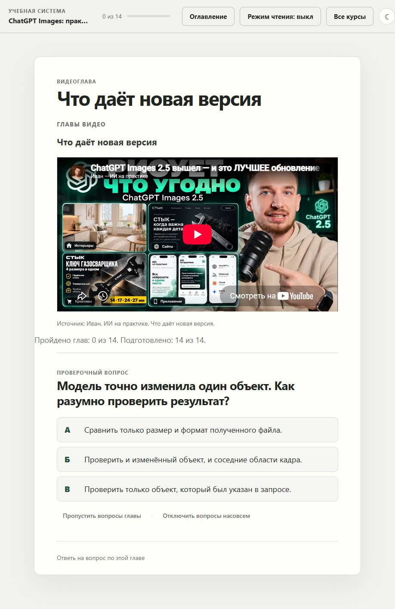
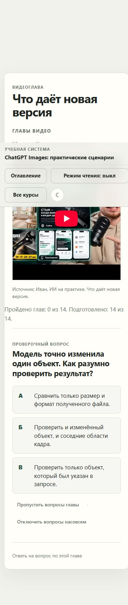

# Adaptive Learning System

Сложный материал небольшими шагами: книги, статьи и видео с проверкой понимания и сохранением прогресса.

Большую книгу, сложную статью или длинный видеокурс трудно освоить за один подход. Основа проекта: разбить материал на небольшие смысловые части, закрепить каждую вопросами и постепенно двигаться дальше.

Система объединяет подготовленный материал, тестирование, объяснения ответов и отдельный прогресс каждого курса. Можно прочитать небольшой фрагмент книги или статьи, посмотреть часть видео, проверить понимание и позже продолжить с сохранённого места.



## Проверка понимания как часть обучения

**Тестирование является важной частью учебного процесса.** После небольшого блока пользователь отвечает на вопросы по материалу, получает объяснение выбранного ответа и видит, что стоит разобрать ещё раз.

Вопросы помогают проверить понимание и применение идеи: почему приём работает, в каком случае он не подходит и что делать в конкретной ситуации. Ошибка сопровождается разбором, чтобы пользователь мог понять причину и вернуться к материалу.

Ответы и пройденные блоки сохраняются. Для самостоятельного просмотра предусмотрен режим без вопросов, а основной учебный сценарий включает проверку понимания.

## С какими материалами можно работать

| Материал | Как организовано обучение |
|---|---|
| Книга или большой учебник | Главы и разделы объединяются в маршрут, внутри идут небольшие смысловые блоки и вопросы |
| Статья или техническое руководство | Материал делится на фрагменты с пояснениями, проверочными вопросами и подготовленной практикой |
| Одно длинное видео | Просмотр по временным интервалам, вопросы после каждой главы |
| Сборник видео | Общий маршрут уроков и отдельный прогресс каждого материала |

Приложение работает с заранее подготовленными пакетами. Выделение частей и подготовка вопросов выполняются отдельно с AI-инструментами, после чего структура пакета проходит проверку. Автоматическая загрузка произвольной книги или видео одной кнопкой пока не реализована.

## Что можно попробовать в этом репозитории

Для быстрого знакомства включён короткий пример по видео **ChatGPT Images: практические сценарии**: 15 минут 12 секунд, 14 глав и 42 вопроса с объяснениями. Это один пример использования общей учебной системы.

1. Открыть курс из библиотеки.
2. Посмотреть короткую главу в официальном YouTube-плеере.
3. Ответить на три вопроса и прочитать объяснения.
4. Перейти к следующей главе или вернуться позже: позиция видео и ответы сохраняются.

Есть оглавление, просмотр пройденных глав, режим без вопросов, архив курсов, поддержка сборников и светлая/тёмная тема. Если YouTube недоступен в конкретной сети, остаётся ссылка на оригинал.

## Мой вклад

Проект вырос из моей личной учебной системы. Я использую её сам и давал студентам для обучения. Определил методику разбора сложного материала небольшими шагами с регулярной проверкой понимания, организовал разработку с AI-инструментами, подготовку вопросов и проверку переходов, прогресса и восстановления состояния.

Это приложение для прохождения **подготовленных** материалов. Автоматический импорт произвольного видео по URL в интерфейсе пока не реализован. Подготовка глав и учебных вопросов выполняется отдельно, затем пакет проходит проверку схемы.

## Запуск

Нужны Node.js 22.12+ и npm. Основная проверка выполнена на Windows с Node.js 24.14.

```sh
git clone https://github.com/dzunnnnn-crypto/adaptive-learning-system.git
cd adaptive-learning-system
npm ci --ignore-scripts
npm start
```

Откройте **http://127.0.0.1:8809/**. Для урока и тестов не нужны API-ключи или учётная запись AI-провайдера. Для воспроизведения видео требуется доступ к YouTube.

При первом запуске создаётся отдельная рабочая библиотека и чистый прогресс в `.local/runtime/`. Она исключена из Git. Повторный запуск сохраняет ответы и позицию видео, а исходный пример в `courses/` остаётся неизменным.

## Как устроено

```text
Книга / статья / видео / сборник
          |
          v
Подготовка небольших смысловых блоков
          |
          v
Материал -> Блок -> Тестирование -> Разбор ответа -> Следующий блок
              |            |
              +------v-----+
             Сохранённый прогресс
```

| Слой | Реализация |
|---|---|
| Сервер и API | Node.js, Express |
| Проверка курсов и запросов | Zod, строгие JSON-схемы |
| Интерфейс | JavaScript ES modules, HTML, CSS |
| Видео | YouTube IFrame Player API, интервалы начала и окончания |
| Состояние | Отдельная Markdown-память каждого курса, JSON-навигация, атомарная запись |
| Учебное тестирование | Вопросы по смысловым блокам, варианты ответов, объяснения и история результатов |
| Проверка кода | Vitest, jsdom, Supertest, сквозная проверка по HTTP |
| Дополнительный AI-слой | Адаптеры Codex SDK и Z.AI, отключены при обычном запуске |

[Архитектура и данные](docs/architecture.md) · [Формат материала](docs/course-format.md) · [Безопасность](SECURITY.md)

## Проверки

```sh
npm run check
npm audit
```

`check` запускает тесты, проверку пакета курса и сквозной HTTP-сценарий: все 14 глав, 42 ответа, завершение и повторный запуск. Тесты используют отдельные временные каталоги.

## Источник учебного примера

Видео: [ChatGPT Images 2.5: практические сценарии](https://www.youtube.com/watch?v=6hT9lEmZzF4), канал «Иван, ИИ на практике».

Видео воспроизводится с YouTube, не хранится в репозитории. Включены таймкоды, самостоятельно подготовленные названия глав, вопросы и объяснения. Полные расшифровки, VTT-файлы и чужие учебные библиотеки не распространяются. Авторство видео не относится к авторству приложения.

Лицензия MIT распространяется на код приложения и наш учебный слой. Права на исходное видео и элементы встроенного плеера остаются у соответствующих правообладателей. Подробнее: [источники и лицензии](THIRD_PARTY_NOTICES.md).

## Границы текущей версии

- Локальное приложение для одного пользователя. Многопользовательский сервер и авторизация не реализованы.
- Готовые вопросы работают без AI. Внешние модели подключаются только явной настройкой, без скрытого переключения провайдера.
- Сохранение прогресса не означает проверку факта просмотра видео или официальную оценку знаний.
- В репозитории нет личных курсов, истории обучения и рабочих API-ключей.

<details>
<summary>Мобильный экран</summary>



</details>
